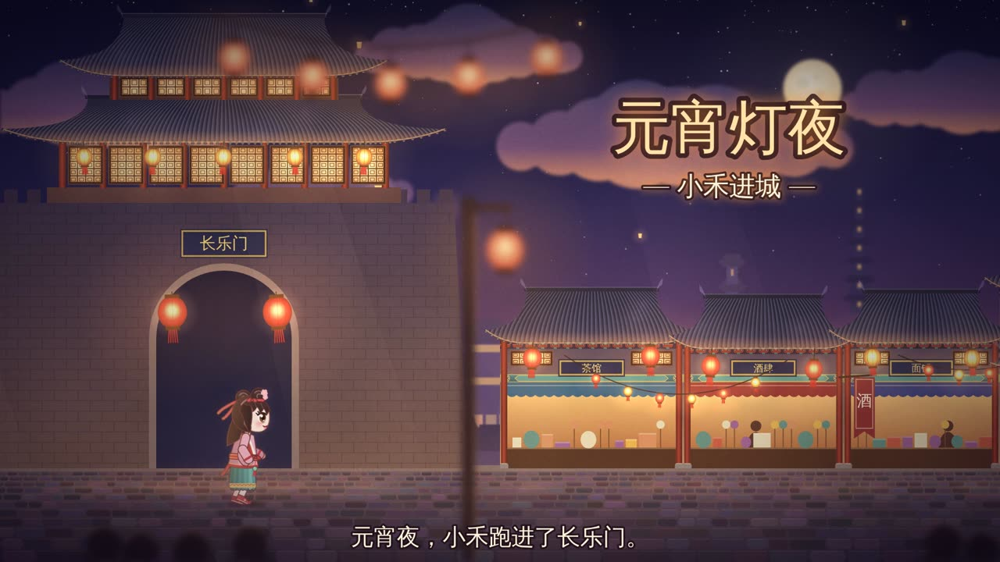

# 元宵灯夜 · 小禾进城

一条 36 秒的 **2.5D 横版卷轴儿童短片**：元宵夜，明代小姑娘「小禾」跑进长乐门，经过灯笼街、铁匠铺兵器架，登上石拱桥看烟花，再穿过打铁花的金雨，最后来到鼓楼前，伴着鼓声挥手说「新年快乐」。

画风目标是《八方旅人》式 HD-2D 体积光与景深，加上吉卜力式手绘水彩。整片由浏览器 Canvas **程序化绘制**，不需要任何外部素材就能直接播放和导出 MP4。之后可以按图层逐步换成 AI 生成或手绘的高质量素材。




## 快速开始

**直接看**：双击 `index.html` 用浏览器打开即可，不需要服务器。

| 按键 | 作用 |
|---|---|
| 空格 | 暂停 / 播放 |
| ← → | 快退 / 快进 2 秒 |
| S | 字幕开关 |
| 点击底部进度条 | 跳转 |

URL 参数：`?t=16` 从第 16 秒开始，`?subs=0` 关闭字幕。

**导出视频**（需要 Node 18+ 和 ffmpeg）：

```bash
npm install
npx playwright install chromium   # 首次使用
npm run render                    # → out/xiaohe-lantern-night.mp4（1920×1080，30fps）
npm run stills                    # 关键帧截图 → out/stills/
```

## 目录结构

```
index.html              播放器入口
src/
  util.js               常量（画幅、世界宽度、视差系数、桥与运河位置）与工具函数
  architecture.js       程序化建筑与道具：翘角屋顶、铺面、城门、鼓楼、石拱桥、柳树、兵器架、铁花棚
  layers.js             预渲染各视差图层，生成灯笼清单，支持用 PNG 替换图层
  fx.js                 灯笼摇曳与光晕、烟花、打铁花、鼓声、孔明灯、水面波光
  girl.js               主角小禾：袄裙 + 双丫髻，2D 骨骼（髋-膝-踝 / 肩-肘-腕 / 颈-头）跑步循环
  main.js               时间线、走位、镜头、逐帧合成、字幕
scripts/render-video.mjs  Playwright 逐帧截图 + ffmpeg 合成 MP4
assets/layers/          放入同名 PNG 即可替换程序化图层（见 docs/pipeline.md）
assets/character/       放入角色序列帧 + manifest.js 即可替换程序化角色
docs/
  prompts.md            AI 绘图 Prompt 包：全景、分层、角色设定/拆件/表情、道具特效
  assets.md             去哪里找好看的素材：AI 出图、约画师、付费/免费素材、授权速查
  pipeline.md           分镜表、图层尺寸规格、角色拆件与骨骼、光影配方、出片与配乐
```

## 视差分层

| 层 | 视差系数 | 内容 |
|---|---|---|
| 天空 | 0 | 夜空渐变、星星 |
| 月与云 | 0.04 | 月亮、被灯火映暖的积云 |
| 烟花 | 0.06 | 程序化烟花（牡丹、垂柳、环形） |
| 远山 | 0.10 | 山脉剪影、山顶宝塔 |
| 孔明灯 | 0.15 | 缓缓升空的孔明灯 |
| 远城 / 中城 | 0.28 / 0.55 | 屋顶天际线、楼阁、窗灯 |
| **主街** | **1.00** | 城门、铺面、兵器架、运河石桥、打铁花、鼓楼、小禾 |
| 前景 | 1.35 | 虚化的灯笼串、灯杆、人群剪影 |

## 用 AI 图替换程序化画面

1. 按 [`docs/prompts.md`](docs/prompts.md) 生成对应图层
2. 按 [`docs/pipeline.md` §2](docs/pipeline.md#2-图层规格视差系数--成品尺寸) 的尺寸导出 PNG，放进 `assets/layers/`（如 `city_mid.png`，4824×1080）
3. 刷新页面即可生效。缺的图层自动回退到程序化版本（浏览器控制台里缺失文件的 `ERR_FILE_NOT_FOUND` 提示属正常现象）

角色同理：把序列帧 PNG 放进 `assets/character/`，复制 `manifest.example.js` 为 `manifest.js` 并填好文件名（见 [`docs/pipeline.md` §3.4](docs/pipeline.md)）。

素材来源与授权注意事项见 [`docs/assets.md`](docs/assets.md)。
