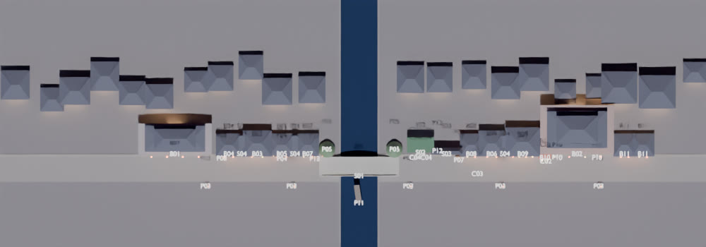
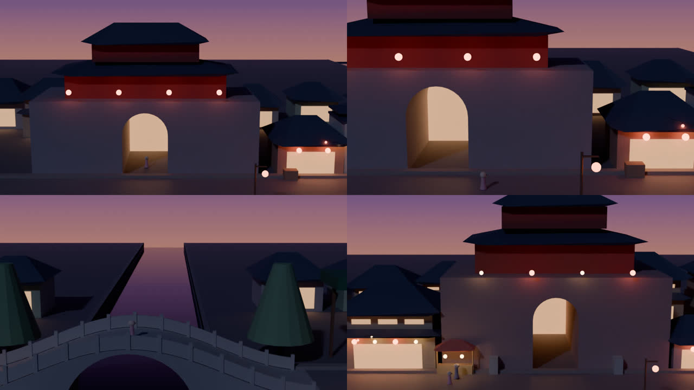

# 3D 素材生成清单（30 个）

流程：**按下面的 Prompt 用 Banana 出图 → 用 Tripo「图片转 3D」生成模型 → 导出 GLB → 按文件名放进 `assets/models/` → 运行 Blender 脚本**，模型就会自动替换掉灰模里对应的方块。

> 尺寸、朝向、落地对齐都由脚本自动处理（按下表的「目标尺寸」缩放），你只需要保证**文件名对**。
> 灰模布局见 `blender/layout.json`，使用方法见 [`blender/README.md`](../../blender/README.md)。




---

## 一、通用规则（每张图都照这个来）

**1. 出图视角：** 3/4 正面俯视（略高于物体，能看到正立面和一点屋顶），物体完整居中、四周留白。横版镜头主要看到的是**正立面**，所以正立面要画清楚；背面 Tripo 会自己补，差一点没关系。

**2. 光照一定要用中性白天光：** 不要在图里画夜景、灯光、发光窗户。贴图会把光影「烤」进模型里，夜景灯光由 Blender 统一打，图里带了反而打架。

**3. 背景：** 纯浅灰背景，不要地面、不要其他物体、不要人。

**4. 招牌留空：** 匾额、幌子都画成空白。AI 写的汉字基本都是错的，中文招牌由我们在 Blender 里用贴图加上。

**5. 统一画风后缀：** 下面每条 Prompt 末尾都已经带上，不用另加：

```
Stylized 3D game asset, hand-painted watercolor texture style with a soft Ghibli-like palette, gentle brush texture, clean readable shapes. Three-quarter front view from slightly above, the whole object fully visible and centered with margin around it. Neutral soft daylight, even lighting, very soft shadows, no night lighting, no glowing lights. Plain light grey background, no ground, no other objects, no people, no text, blank signboards.
```

**6b. 本地混元3D（ComfyUI）：** 也可以在自己的显卡上批量转换（只出白模），见 [`tools/comfyui/README.md`](../../tools/comfyui/README.md)。图片按总表的文件名命名即可直接批量处理。

**6. Tripo 设置：** 选「图片转 3D」。有高清贴图选项就打开。面数用中等即可（建筑 5~15 万面，小道具 1~3 万面），导出 **GLB** 格式。

**7. 风格一致的小技巧：** 第一张满意的建筑图出来后，后面每张都把它作为参考图一起发给 Banana，并加一句 `Match the art style, colors and level of detail of the reference image.`

**8. 建议顺序：** 先做 **P01 红灯笼、B04 酒肆、C01 小禾** 这 3 个，发给我验证整条流程没问题，再批量做剩下的。

---

## 二、总表

| 优先级 | ID | 名称 | 文件名 | 目标尺寸 宽×深×高（米） |
|---|---|---|---|---|
| ⭐ 必做 | C01 | 小禾（主角，A 字站姿） | `C01_xiaohe.glb` | 身高 1.35 |
| ⭐ 必做 | B01 | 城门楼 | `B01_city_gate.glb` | 24 × 10 × 16 |
| ⭐ 必做 | B02 | 鼓楼 | `B02_drum_tower.glb` | 24 × 16 × 20 |
| ⭐ 必做 | B03 | 两层茶馆 | `B03_teahouse.glb` | 8 × 7 × 8.5 |
| ⭐ 必做 | B04 | 酒肆 | `B04_tavern.glb` | 7 × 6 × 6 |
| ⭐ 必做 | B05 | 铁匠铺 | `B05_blacksmith.glb` | 7 × 6 × 5.5 |
| ⭐ 必做 | B06 | 两层绸缎庄 | `B06_cloth_shop.glb` | 7 × 7 × 8 |
| ⭐ 必做 | B07 | 药铺 | `B07_pharmacy.glb` | 6 × 6 × 5.5 |
| ⭐ 必做 | S01 | 单孔石拱桥 | `S01_stone_bridge.glb` | 26 × 6.4 × 4.6 |
| ⭐ 必做 | S02 | 打铁花花棚 | `S02_iron_flower_shed.glb` | 8 × 5 × 7 |
| ⭐ 必做 | P01 | 红灯笼 | `P01_red_lantern.glb` | 高 0.9 |
| ⭐ 必做 | P02 | 琥珀色羊角灯 | `P02_horn_lantern.glb` | 高 0.6 |
| ⭐ 必做 | P04 | 兵器架 | `P04_weapon_rack.glb` | 2.6 × 0.8 × 3 |
| ⭐ 必做 | P05 | 柳树 | `P05_willow.glb` | 高 8 |
| 推荐 | B08 | 灯笼铺 | `B08_lantern_shop.glb` | 6 × 6 × 6 |
| 推荐 | B09 | 客栈 | `B09_inn.glb` | 10 × 8 × 9 |
| 推荐 | B10 | 小吃摊棚 | `B10_food_stall.glb` | 4 × 3 × 3.5 |
| 推荐 | B11 | 普通民居（填充 + 后排） | `B11_house.glb` | 6 × 6 × 5.5 |
| 推荐 | S03 | 牌坊 | `S03_paifang.glb` | 10 × 2 × 9 |
| 推荐 | S04 | 封火山墙（楼与楼之间的连接件） | `S04_firewall.glb` | 1.6 × 6 × 7 |
| 推荐 | P03 | 灯杆（前景） | `P03_lantern_pole.glb` | 高 4.6 |
| 推荐 | P07 | 货郎推车 | `P07_vendor_cart.glb` | 2.2 × 1.2 × 1.8 |
| 推荐 | P10 | 石狮子 | `P10_stone_lion.glb` | 高 1.7 |
| 推荐 | P11 | 乌篷船 | `P11_boat.glb` | 1.8 × 6 × 1.4 |
| 可选 | P08 | 酒坛与箩筐 | `P08_jars_baskets.glb` | 1.4 × 1 × 1 |
| 可选 | P12 | 梅花树 | `P12_plum_tree.glb` | 高 5 |
| 可选 | P13 | 货摊桌 | `P13_market_table.glb` | 2 × 1 × 1.1 |
| 可选 | C02 | 摊贩老伯（静态） | `C02_vendor.glb` | 身高 1.65 |
| 可选 | C03 | 提兔子灯的小孩（静态） | `C03_child_lantern.glb` | 身高 1.15 |
| 可选 | C04 | 打铁花艺人（静态） | `C04_iron_performer.glb` | 身高 1.75 |

**不需要生成的（由脚本或 Blender 程序化完成）：** 青石板路、台基、运河水面和驳岸、远处城市和山（用 Banana 画一张 2D 宽幅背景板即可，见第五节）、天空、烟花和打铁花火星、孔明灯、灯笼串的绳子、中文招牌和幌子文字、雾和灯光。

---

## 三、逐个 Prompt

> 每条都可以直接整段复制到 Banana。中文是给你看的说明。

### C01 小禾（主角）⭐

要求：**正面、A 字站姿**（双臂自然张开约 30°），便于 Tripo / Mixamo 自动绑骨。袖子收窄、裙子到小腿中部，避免宽大飘带，否则绑骨后容易穿模。

```
Full body character for 3D rigging: a cheerful ten-year-old Chinese girl in modest Ming Dynasty clothing, cute slightly chibi proportions (large head). Lotus-pink cross-collar short jacket with red trim and fitted sleeves, red sash belt with a small jade pendant, teal pleated horse-face skirt reaching mid-calf with a gold hem band, white trousers, red embroidered cloth shoes, twin hair buns tied with short red ribbons and a small pink flower, friendly smile. Strict front view, A-pose with arms held about 30 degrees away from the body, legs slightly apart, standing straight, symmetrical. Stylized 3D game character, hand-painted watercolor texture style with a soft Ghibli-like palette, clean readable shapes. Neutral soft daylight, even lighting, no shadows. Plain light grey background, nothing else in the image, no text.
```

### B01 城门楼 ⭐

城台很厚，正中一个拱形门洞（门洞要能看穿），上面一座两层重檐门楼。

```
A massive Ming Dynasty city gate: a thick grey-brick fortress platform with crenellated parapets and one large arched tunnel gateway through the middle, topped by a two-story gate tower with red wooden pillars, wooden lattice windows and double-eaved sweeping grey tiled roofs with upturned corners, a blank dark plaque above the arch. Wide and imposing, about one and a half times as wide as it is tall. Stylized 3D game asset, hand-painted watercolor texture style with a soft Ghibli-like palette, gentle brush texture, clean readable shapes. Three-quarter front view from slightly above, the whole object fully visible and centered with margin around it. Neutral soft daylight, even lighting, very soft shadows, no night lighting, no glowing lights. Plain light grey background, no ground, no other objects, no people, no text, blank signboards.
```

### B02 鼓楼 ⭐

结尾地标。砖砌高台带拱门，上面两层木楼，二层能看到一面大红鼓。

```
A grand Ming Dynasty drum tower: a tall red-plastered brick platform with one arched gateway through the center, topped by a two-story wooden hall with red pillars, carved lattice windows, an open upper gallery where one large red drum on a wooden stand is visible, and double-eaved sweeping grey tiled roofs with upturned corners, a blank plaque between the eaves. Stately and symmetrical, slightly wider than tall. Stylized 3D game asset, hand-painted watercolor texture style with a soft Ghibli-like palette, gentle brush texture, clean readable shapes. Three-quarter front view from slightly above, the whole object fully visible and centered with margin around it. Neutral soft daylight, even lighting, very soft shadows, no night lighting, no glowing lights. Plain light grey background, no ground, no other objects, no people, no text, blank signboards.
```

### B03 两层茶馆 ⭐

```
A two-story Ming Dynasty teahouse shopfront: open ground floor with folding wooden lattice doors pulled aside and a wooden counter with tea pots and cups, a small pent roof between the floors, an upper floor with a wooden balcony railing and paper lattice windows, curved grey tiled roof with upturned eaves, red-brown wooden pillars, a blank horizontal signboard above the entrance. About as tall as it is wide. Stylized 3D game asset, hand-painted watercolor texture style with a soft Ghibli-like palette, gentle brush texture, clean readable shapes. Three-quarter front view from slightly above, the whole object fully visible and centered with margin around it. Neutral soft daylight, even lighting, very soft shadows, no night lighting, no glowing lights. Plain light grey background, no ground, no other objects, no people, no text, blank signboards.
```

### B04 酒肆 ⭐（建议第一个试）

```
A one-story Ming Dynasty tavern shopfront: open front with a wooden counter and stacked clay wine jars, wooden pillars, plastered walls, a curved grey tiled roof with upturned eaves, a tall wooden pole beside the door with a blank cloth wine flag, a blank horizontal signboard above the entrance. Slightly wider than tall. Stylized 3D game asset, hand-painted watercolor texture style with a soft Ghibli-like palette, gentle brush texture, clean readable shapes. Three-quarter front view from slightly above, the whole object fully visible and centered with margin around it. Neutral soft daylight, even lighting, very soft shadows, no night lighting, no glowing lights. Plain light grey background, no ground, no other objects, no people, no text, blank signboards.
```

### B05 铁匠铺 ⭐

炉子不要画成发光的，火光到 Blender 里加。

```
A one-story Ming Dynasty blacksmith workshop: wide open front showing a brick forge (not lit), an iron anvil on a tree stump, hammers and tongs hanging on the wall, a water barrel, dark timber frame, a slightly sooty grey tiled roof with upturned eaves, a blank signboard. Slightly wider than tall. Stylized 3D game asset, hand-painted watercolor texture style with a soft Ghibli-like palette, gentle brush texture, clean readable shapes. Three-quarter front view from slightly above, the whole object fully visible and centered with margin around it. Neutral soft daylight, even lighting, very soft shadows, no night lighting, no glowing lights. Plain light grey background, no ground, no other objects, no people, no text, blank signboards.
```

### B06 两层绸缎庄 ⭐

```
A two-story Ming Dynasty silk and cloth shop: ground floor open front with shelves of colorful folded fabric bolts and a long wooden counter, rolls of silk hanging on display, an upper floor with lattice windows and a small balcony, a pent roof between floors, curved grey tiled roof with upturned eaves, dark red pillars, a blank horizontal signboard. Slightly taller than wide. Stylized 3D game asset, hand-painted watercolor texture style with a soft Ghibli-like palette, gentle brush texture, clean readable shapes. Three-quarter front view from slightly above, the whole object fully visible and centered with margin around it. Neutral soft daylight, even lighting, very soft shadows, no night lighting, no glowing lights. Plain light grey background, no ground, no other objects, no people, no text, blank signboards.
```

### B07 药铺 ⭐

```
A one-story Ming Dynasty herbal medicine shop: open front with a tall wooden wall cabinet of many small drawers, a counter with a brass scale and paper packets, dried herbs hanging in bundles, white plaster walls with wooden frame, curved grey tiled roof with upturned eaves, a blank signboard. About as wide as tall. Stylized 3D game asset, hand-painted watercolor texture style with a soft Ghibli-like palette, gentle brush texture, clean readable shapes. Three-quarter front view from slightly above, the whole object fully visible and centered with margin around it. Neutral soft daylight, even lighting, very soft shadows, no night lighting, no glowing lights. Plain light grey background, no ground, no other objects, no people, no text, blank signboards.
```

### S01 单孔石拱桥 ⭐

用**正侧面**（能看到完整的半圆桥洞），桥要长、桥面坡度平缓。生成效果不好也没关系，脚本里有程序化的石桥可以直接用。

```
A single-arch Chinese stone bridge, long and gently humped, one large semicircular arch, grey granite blocks, carved stone balustrade panels with small square posts along both sides, wide stone steps on both ends. Strict side view showing the full arch, with a slight top-down angle. Stylized 3D game asset, hand-painted watercolor texture style with a soft Ghibli-like palette, gentle brush texture, clean readable shapes. The whole object fully visible and centered with margin around it. Neutral soft daylight, even lighting, very soft shadows. Plain light grey background, no water, no ground, no other objects, no people, no text.
```

### S02 打铁花花棚 ⭐

```
A tall wooden scaffold canopy used for the traditional Chinese molten-iron fireworks performance (da tie hua): four tall rough wooden poles with cross beams and diagonal braces, a flat roof densely covered with green pine branches, many strings of small red firecrackers hanging from the roof edge. Taller than wide. Stylized 3D game asset, hand-painted watercolor texture style with a soft Ghibli-like palette, gentle brush texture, clean readable shapes. Three-quarter front view from slightly above, the whole object fully visible and centered with margin around it. Neutral soft daylight, even lighting, very soft shadows, no night lighting, no glowing lights. Plain light grey background, no ground, no other objects, no people, no text.
```

### P01 红灯笼 ⭐（建议第一个试）

会被复制上百次，造型越简洁越好。

```
A single traditional Chinese round red silk lantern: plump oval shape with thin vertical ribs, small gold-colored wooden caps on top and bottom, a short hanging cord loop on top and a red silk tassel underneath. Front view, perfectly upright. Stylized 3D game asset, hand-painted watercolor texture style with a soft Ghibli-like palette, clean simple shape. Neutral soft daylight, even lighting, not glowing. Plain light grey background, nothing else in the image, no text.
```

### P02 琥珀色羊角灯 ⭐

```
A single traditional Chinese horn lantern: hexagonal shape with a thin dark wooden frame and translucent pale amber panels, small curved wooden top with a hanging hook, short tassel underneath. Front view, perfectly upright. Stylized 3D game asset, hand-painted watercolor texture style with a soft Ghibli-like palette, clean simple shape. Neutral soft daylight, even lighting, not glowing. Plain light grey background, nothing else in the image, no text.
```

### P04 兵器架 ⭐

```
A wooden weapon display rack outside a blacksmith shop: a sturdy dark wooden frame holding five upright spears with red horsehair tassels below shiny steel spear tips, and two curved Chinese sabers resting crosswise on the lower bar. Display props, clean and decorative. Stylized 3D game asset, hand-painted watercolor texture style with a soft Ghibli-like palette, gentle brush texture, clean readable shapes. Three-quarter front view from slightly above, the whole object fully visible and centered with margin around it. Neutral soft daylight, even lighting, very soft shadows. Plain light grey background, no ground, no other objects, no people, no text.
```

### P05 柳树 ⭐

```
A single weeping willow tree with a gnarled dark trunk and long drooping curtain-like branches of soft green leaves, graceful rounded silhouette. Stylized 3D game asset, hand-painted watercolor texture style with a soft Ghibli-like palette, gentle brush texture, clean readable shapes, leaves grouped into soft clumps rather than individual leaves. Three-quarter view, the whole tree fully visible and centered with margin around it. Neutral soft daylight, even lighting, very soft shadows. Plain light grey background, no ground, no other objects, no text.
```

### B08 灯笼铺

```
A one-story Ming Dynasty lantern shop: open front with many colorful paper and silk lanterns of different shapes hanging from the eaves and displayed on shelves (round, cylindrical, rabbit-shaped, lotus-shaped), a wooden counter, curved grey tiled roof with upturned eaves, a blank signboard. About as wide as tall. Stylized 3D game asset, hand-painted watercolor texture style with a soft Ghibli-like palette, gentle brush texture, clean readable shapes. Three-quarter front view from slightly above, the whole object fully visible and centered with margin around it. Neutral soft daylight, even lighting, very soft shadows, no night lighting, no glowing lights. Plain light grey background, no ground, no other objects, no people, no text, blank signboards.
```

### B09 客栈

```
A wide two-story Ming Dynasty inn with three bays: central double wooden entrance doors, wooden lattice windows across the upper floor with a long balcony railing, a pent roof between floors, a large curved grey tiled roof with upturned eaves, red pillars, a blank horizontal signboard over the entrance. Wider than tall. Stylized 3D game asset, hand-painted watercolor texture style with a soft Ghibli-like palette, gentle brush texture, clean readable shapes. Three-quarter front view from slightly above, the whole object fully visible and centered with margin around it. Neutral soft daylight, even lighting, very soft shadows, no night lighting, no glowing lights. Plain light grey background, no ground, no other objects, no people, no text, blank signboards.
```

### B10 小吃摊棚

```
A small Chinese street food stall: four thin wooden posts holding a slanted red-and-white cloth canopy, a wooden cart counter with steamer baskets stacked high, a small clay stove (not lit), bowls and a ladle, a few wooden stools. Stylized 3D game asset, hand-painted watercolor texture style with a soft Ghibli-like palette, gentle brush texture, clean readable shapes. Three-quarter front view from slightly above, the whole object fully visible and centered with margin around it. Neutral soft daylight, even lighting, very soft shadows, no glowing lights. Plain light grey background, no ground, no other objects, no people, no text.
```

### B11 普通民居（填充 / 后排）

会被复制很多次放在街道后排，越朴素越好。

```
A simple modest Ming Dynasty residential house: white plaster walls with a dark wooden frame, a small wooden door, one paper lattice window, a plain curved grey tiled roof with slightly upturned eaves. Simple and unadorned. Stylized 3D game asset, hand-painted watercolor texture style with a soft Ghibli-like palette, gentle brush texture, clean readable shapes. Three-quarter front view from slightly above, the whole object fully visible and centered with margin around it. Neutral soft daylight, even lighting, very soft shadows. Plain light grey background, no ground, no other objects, no people, no text.
```

### S03 牌坊

```
A Ming Dynasty wooden memorial archway (pailou) with three openings: four red lacquered pillars on stone bases, painted blue-green beams with gold patterns, three small sweeping grey tiled roofs on top with the middle one highest, a blank plaque in the center. Wide and symmetrical, freestanding. Stylized 3D game asset, hand-painted watercolor texture style with a soft Ghibli-like palette, gentle brush texture, clean readable shapes. Three-quarter front view from slightly above, the whole object fully visible and centered with margin around it. Neutral soft daylight, even lighting, very soft shadows. Plain light grey background, no ground, no other objects, no people, no text, blank signboards.
```

### S04 封火山墙（连接件）

放在两栋楼之间盖住接缝，所以要**窄而高**。

```
A narrow freestanding segment of a white-plastered Chinese gable firewall (horse-head wall) with stepped tops capped by grey tiles, a small dark arched alley doorway at the bottom, slight weathering stains. Tall and narrow, about four times taller than wide when seen from the front. Stylized 3D game asset, hand-painted watercolor texture style with a soft Ghibli-like palette, gentle brush texture, clean readable shapes. Three-quarter front view from slightly above, the whole object fully visible and centered with margin around it. Neutral soft daylight, even lighting, very soft shadows. Plain light grey background, no ground, no other objects, no people, no text.
```

### P03 灯杆（前景）

```
A tall dark wooden street lantern pole with a curved bracket arm at the top and one round red silk lantern hanging from it, a small stone base. Tall and slender. Stylized 3D game asset, hand-painted watercolor texture style with a soft Ghibli-like palette, clean readable shapes. Front three-quarter view, the whole object fully visible and centered with margin around it. Neutral soft daylight, even lighting, not glowing. Plain light grey background, nothing else in the image, no text.
```

### P07 货郎推车

```
A traditional Chinese wooden peddler's hand cart with two large spoked wheels, loaded with toys and snacks: pinwheels, small drums, candied hawthorn skewers, little paper lanterns. Stylized 3D game asset, hand-painted watercolor texture style with a soft Ghibli-like palette, gentle brush texture, clean readable shapes. Three-quarter front view from slightly above, the whole object fully visible and centered with margin around it. Neutral soft daylight, even lighting, very soft shadows. Plain light grey background, no ground, no other objects, no people, no text.
```

### P10 石狮子

```
A single Chinese guardian stone lion statue sitting on a square stone plinth, curly mane, one front paw resting on a ball, friendly rather than fierce expression, grey granite. Stylized 3D game asset, hand-painted watercolor texture style with a soft Ghibli-like palette, gentle brush texture, clean readable shapes. Three-quarter front view, the whole object fully visible and centered with margin around it. Neutral soft daylight, even lighting, very soft shadows. Plain light grey background, nothing else in the image, no text.
```

### P11 乌篷船

```
A small traditional Chinese canal boat (wupeng boat) with a dark curved woven bamboo canopy in the middle, a long wooden hull with pointed ends, a long wooden oar resting on the stern. Stylized 3D game asset, hand-painted watercolor texture style with a soft Ghibli-like palette, gentle brush texture, clean readable shapes. Three-quarter view from slightly above, the whole boat fully visible and centered with margin around it. Neutral soft daylight, even lighting, very soft shadows. Plain light grey background, no water, nothing else in the image, no text.
```

### P08 酒坛与箩筐

```
A small cluster of props: three brown glazed clay wine jars with red paper seals on their lids, two woven bamboo baskets with vegetables, a small wooden crate. Stylized 3D game asset, hand-painted watercolor texture style with a soft Ghibli-like palette, gentle brush texture, clean readable shapes. Three-quarter front view from slightly above, everything fully visible and centered with margin around it. Neutral soft daylight, even lighting, very soft shadows. Plain light grey background, no ground, no people, no text.
```

### P12 梅花树

```
A small Chinese plum blossom tree with a twisting dark trunk and branches covered in soft pink blossoms, airy rounded crown. Stylized 3D game asset, hand-painted watercolor texture style with a soft Ghibli-like palette, gentle brush texture, blossoms grouped into soft clumps. Three-quarter view, the whole tree fully visible and centered with margin around it. Neutral soft daylight, even lighting, very soft shadows. Plain light grey background, no ground, nothing else in the image, no text.
```

### P13 货摊桌

```
A small wooden market table loaded with goods: sugar figurines on sticks, colorful paper windmills, small rabbit lanterns (not lit), a basket of oranges. Stylized 3D game asset, hand-painted watercolor texture style with a soft Ghibli-like palette, gentle brush texture, clean readable shapes. Three-quarter front view from slightly above, everything fully visible and centered with margin around it. Neutral soft daylight, even lighting, very soft shadows. Plain light grey background, no ground, no people, no text.
```

### C02 摊贩老伯（静态）

不绑骨，直接摆好姿势。

```
A friendly elderly Ming Dynasty street vendor man in a simple blue-grey cotton robe and a black cloth cap, white beard, gently smiling, standing with one hand raised as if offering a steamed bun. Full body. Stylized 3D game character, hand-painted watercolor texture style with a soft Ghibli-like palette, clean readable shapes. Three-quarter front view, fully visible and centered. Neutral soft daylight, even lighting. Plain light grey background, nothing else in the image, no text.
```

### C03 提兔子灯的小孩（静态）

```
A small happy Chinese child about six years old in a padded red winter jacket and green trousers, hair in a little topknot, holding up a white rabbit-shaped paper lantern on a short stick (not lit). Full body, standing. Stylized 3D game character, cute chibi proportions, hand-painted watercolor texture style with a soft Ghibli-like palette, clean readable shapes. Three-quarter front view, fully visible and centered. Neutral soft daylight, even lighting. Plain light grey background, nothing else in the image, no text.
```

### C04 打铁花艺人（静态）

```
A strong traditional Chinese iron-flower fireworks performer wearing a protective inverted gourd-shaped straw hat and a thick sheepskin vest over a simple tunic, holding a long wooden stick raised overhead with both hands, mid-swing pose. Full body. Stylized 3D game character, hand-painted watercolor texture style with a soft Ghibli-like palette, clean readable shapes. Three-quarter front view, fully visible and centered. Neutral soft daylight, even lighting, no sparks. Plain light grey background, nothing else in the image, no text.
```

---

## 四、生成后检查（每个模型过一遍）

- 正立面是否清楚、比例是否接近总表（太离谱就重新出图）
- 底部是不是平的（Tripo 偶尔会在底下生成一块地面，可以在 Blender 里删掉）
- 文件名与总表**完全一致**，放进 `assets/models/`

## 五、额外 1 张 2D 远景背景板（不算在 30 个里）

放在场景最远处，补足远处的城市、宝塔和山，文件名 `assets/backdrop/far_city.png`（建议 21:9 或更宽，天空部分最好用透明或纯色，方便抠掉）：

```
A very wide panoramic background painting of a distant Ming Dynasty city at night during the Lantern Festival: layers of tiled rooftops fading into purple haze, a tall pagoda with tiny warm window lights, soft rolling mountains behind, many tiny warm lantern lights scattered among the roofs. Hand-painted watercolor style like a Studio Ghibli background, soft and atmospheric, low contrast. Strict side view, flat horizon, the bottom of the image is rooftops (no street, no foreground buildings). Plain solid dark blue sky. No people, no text. 21:9 ultra-wide.
```
